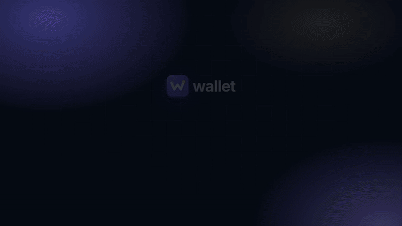

<p align="center">
  
</p>
<h1 align="center">wallet</h1>
<p align="center"><b>Your money, on your machine.</b><br>
Net worth, budgets and investments in any currency, with an AI assistant you can drop bank statements on.<br>
Self-hosted · one SQLite file · passkey sign-in · MIT</p>

<p align="center">
  <a href="https://clanker-labs.github.io/wallet/"><b>Docs & demos</b></a> ·
  <a href="https://clanker-labs.github.io/wallet/media/demo.mp4">Full demo (video)</a> ·
  <a href="https://clanker-labs.github.io/wallet/getting-started.html">Get started</a> ·
  <a href="https://clanker-labs.github.io/wallet/architecture.html">How it works</a>
</p>

<p align="center">
  <a href="https://clanker-labs.github.io/wallet/"></a>
</p>

## What it does

- **Net worth** across cash, stocks, retirement, property, crypto, gold and loans. Plotted daily, with a daily-change view and *what moved* it (which accounts, and whether it was the market, a new balance, a loan or a job). Allocation, partly-owned assets, and mortgages that amortize on their own.
- **Budgets in any currency.** Each envelope has its own currency (rent in EUR, groceries in AED); spending in other currencies counts at that day's rate, and the whole page can be shown in any currency. Moves between your own accounts are matched and kept out of spending.
- **Recurring payments.** Salary, rent and subscriptions as expectations matched to the real payments from your statements — late ones flagged, price rises noticed, a 90-day cash forecast, never a duplicate.
- **Companies.** Businesses you own as assets — valued from their books, revenue or profit — with their revenue, spending and profit by month.
- **Tax by country.** A yearly estimate: UAE and French rules (non-resident rental income, IFI, corporate tax), stays per country for residency.
- **Goals, splits, tags, smarter rules, loan repayments, sharing with a partner, an audit trail, daily backups with restore, offline reading.**
- **Jobs and end-of-service gratuity.** Add a job and its gratuity accrues every day as an asset, under the law of its country: UAE (mainland and DIFC/DEWS), Saudi Arabia, Qatar, France, or a rule of your own. Raises, resign-vs-let-go, the next step-up date, and an accrual chart with where it goes if you stay.
- **Any currency.** USD by default. Every account, holding and transaction keeps its own currency, converted daily with free exchange rates.
- **Investments.** Stocks, ETFs, funds, crypto and commodities with daily prices and gains. Physical gold takes a manual price.
- **Brokerage sync.** Connect Trading 212 with a read-only API key: positions, average prices and cash are mirrored hourly. wallet never places an order.
- **Brokerage history.** With the key's History permissions, past fills, dividends, deposits, withdrawals and interest are imported (twice a day, at Trading 212's pace) and the account's value is rebuilt for every day back to the first one — anchored on today's positions and cash, valued at market closes or the broker's own fill prices. That gives a true time-weighted return (deposits taken out), a money-weighted return (XIRR), money in vs worth, and dividends, interest and realised gains by month.
- **Budgets.** Monthly envelopes with a pace marker, savings rate and cash flow.
- **Drop a statement, it's imported.** CSV, PDF or a screenshot, anywhere in the app or sent to the Telegram bot. The assistant runs on the Claude API, or on your local `claude` / `codex` login.
- **MCP & API.** The same 64 tools for Claude Code, Codex, Claude Desktop or plain HTTP. No token needed on localhost.
- **Telegram reminders** re-send until you tap ✅. `/update` asks for one balance at a time.
- **Simulations** for mortgages, borrowing capacity, buy vs rent, and a net-worth projection.
- **Passkeys only.** Face ID on your iPhone through a QR code; no passwords, no OAuth. Several users per install, each with private data.

Every feature has a short video on the [docs site](https://clanker-labs.github.io/wallet/).

## Quick start

```bash
npm install
npm run dev          # http://localhost:3000 → create your account with a passkey
```

Want to look around first? Load the demo data, then open the one-time sign-in link it prints:

```bash
npm run db:seed-demo && npm run auth:link
```

Node 22+. For Docker, Telegram, the assistant and HTTPS (passkeys need it outside localhost), see [Getting started](https://clanker-labs.github.io/wallet/getting-started.html) and [Configuration](https://clanker-labs.github.io/wallet/configuration.html).

## Docs

| | |
|---|---|
| [Features](https://clanker-labs.github.io/wallet/) | Each page has its demo video: net worth, accounts, investments, budgets, transactions, assistant, simulations, Telegram, settings |
| [Architecture](https://clanker-labs.github.io/wallet/architecture.html) | Layers, request flow, multi-user isolation |
| [Security](https://clanker-labs.github.io/wallet/security.html) | Passkeys, sessions, the local-only token-less API, the agent's SQL sandbox |
| [Agent tools](https://clanker-labs.github.io/wallet/tools.html) · [HTTP API](https://clanker-labs.github.io/wallet/api.html) | Generated from the code |
| [Data model](https://clanker-labs.github.io/wallet/data-model.html) · [Configuration](https://clanker-labs.github.io/wallet/configuration.html) | Every table and every environment variable |

## Development

```bash
npm test                 # vitest
npm run typecheck
npm run site:build       # docs site → site-dist/
node scripts/demo/record-all.mjs   # re-record the demo videos (see scripts/demo/README.md)
```

Next.js 16 · React 19 · SQLite (better-sqlite3 + drizzle) · Tailwind v4 · Recharts. Notes for coding agents are in [AGENTS.md](AGENTS.md).
